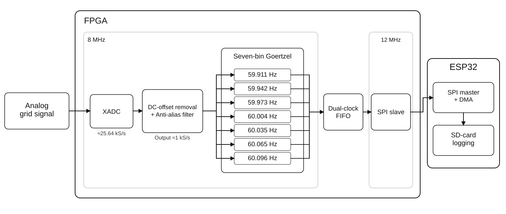

# FPGA-Based Power-Grid Signal Processing

Subtle fluctuations in the power grid's nominal 60 Hz frequency—known as electrical network frequency (ENF)—can provide a timing signature in recorded signals. Variations in signal power can also help distinguish recording locations. Rather than transmitting raw waveforms for offline analysis, the Goertzel algorithm efficiently extracts selected frequency components, enabling compact processing at the edge.

This project, developed in the Shah Lab at the University of Maryland, implements an FPGA-based acquisition and signal-processing pipeline on an Arty S7. The FPGA handles time-critical sampling, anti-aliasing, and Goertzel processing, while an ESP32 receives data over SPI and logs it to an SD card. I explored parallel and time-multiplexed Verilog designs and validated the hardware using simulations, MATLAB models, and FPGA captures.

[Architecture](#system-architecture) · [Pipeline](#how-it-works) · [Validation](#validation-strategy) · [Results](#key-results) · [Project Files](#explore-the-project) · [References](#references)

## System Architecture

## How It Works

Unlike an FFT, which computes a full frequency spectrum, Goertzel focuses on selected frequencies. This implementation uses seven bins near 60 Hz to extract grid-frequency information efficiently on an FPGA.

1. **Acquire and decimate.** The FPGA's XADC samples the analog signal. DC-offset removal and anti-aliasing with a cascaded integrator-comb (CIC) filter reduce the sample rate from about 25.64 kS/s to 986 samples/s.
2. **Extract selected frequencies.** The seven-bin Goertzel processor computes the frequency components needed for offline spectral-power and ENF analysis.
3. **Transfer and analyze.** A dual-clock FIFO and SPI interface transfer results to an ESP32 for SD-card logging. MATLAB analyzes the captures and verifies the hardware outputs against numerical models.

## Validation Strategy

Development and validation followed four stages:

1. **FPGA–ESP32 transport:** Verified reliable data transfer using deterministic test patterns and SD-card captures.
2. **MATLAB DSP design:** Evaluated anti-aliasing, frequency selection, and fixed-point precision before hardware implementation.
3. **RTL implementation and simulation:** Implemented the processing pipeline in Verilog and tested its arithmetic and control logic using self-checking testbenches.
4. **FPGA hardware validation:** Captured CIC and Goertzel outputs and compared them against theoretical predictions and MATLAB models.

Separate MATLAB studies explored ENF frequency calibration and ENV-related spectral features using historical recordings.

## Key Results

| Result | What it demonstrates |
|---|---|
| 85.7% fewer DSP48E1 blocks | Shared Goertzel architecture reduced standalone synthesis usage from 28 to 4 blocks. |
| 126/126 bit-exact states | FPGA Goertzel outputs matched an independent MATLAB integer model across nine captured windows. |
| 286,463 frames without detected errors | No framing, sequence, or payload errors were detected in the FPGA–ESP32 transport test. |
| 84% less ENF estimator disagreement | MATLAB calibration reduced mean Goertzel-to-MUSIC disagreement from 3.809 to 0.610 mHz. |

## Explore the Project

| Stage | Architecture & implementation | Verification & results |
|---|---|---|
| FPGA–ESP32 transport | [Architecture](architecture-docs/fpga_esp32_transport.md) · [SPI RTL](rtl/transport/) · [ESP32 firmware](firmware/README.md) | [Transport integrity](results/hardware-validation/transport/README.md) · [Transport testbenches](tb/transport/) |
| CIC preprocessing | [CIC design](architecture-docs/cic_decimator.md) · [RTL](rtl/preprocessing/) · [FPGA top](rtl/validation_only/cic_top.v) | [Frequency response & alias rejection](results/hardware-validation/cic/README.md) · [Preprocessing testbenches](tb/preprocessing/) |
| Goertzel processing | [Architecture & fixed-point design](architecture-docs/goertzel.md) · [Parallel RTL](rtl/goertzel/parallel/) · [Shared RTL](rtl/goertzel/shared/) | [FPGA validation](results/hardware-validation/goertzel/README.md) · [Synthesis comparison](results/synthesis/README.md) · [Testbenches](tb/goertzel/) |
| ENF/ENV feature analysis | [MATLAB studies](matlab/enf-env-calibration/) · [Numerical models](matlab/fixed-point-models/) | [Calibration & recorded-signal results](results/enf-env-calibration/README.md) |

## References

1. R. Garg, A. L. Varna, A. Hajj-Ahmad, and M. Wu, *“Seeing” ENF: Power-Signature-Based Timestamp for Digital Multimedia via Optical Sensing and Signal Processing*, *IEEE Transactions on Information Forensics and Security*, 2013.
2. M. Zhang et al., *Feasibility Study of Location Authentication for IoT Data Using Power Grid Signatures*, *IEEE Open Journal of Signal Processing*, 2025.
