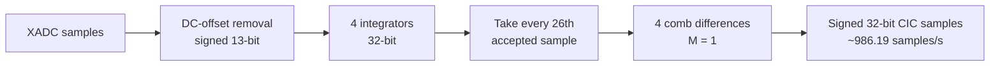

# CIC Decimator: Design and RTL Architecture

The CIC (cascaded integrator-comb) stage reduces the FPGA's DC-centered ADC stream from approximately 25.64 kS/s to 986.19 samples/s before narrowband 60 Hz feature extraction. A CIC is attractive here because it performs decimation using adders, subtractors, counters, and registers, without multiplier coefficients.

The central tradeoff is stronger suppression of interfering frequencies versus greater attenuation of wanted harmonics and wider arithmetic.

## Signal path and selected configuration



| Parameter | Implemented value |
|---|---:|
| Decimation factor, R | 26 |
| Integrator/comb stages, N | 4 each |
| Comb differential delay, M | 1 |
| Nominal input rate | 25,641.026 samples/s |
| Nominal output rate | 986.193294 samples/s |
| Input format | Signed 13-bit, after offset removal |
| Internal and output format | Signed 32-bit |
| DC gain before normalization | (26 × 1)^4 = 456,976 |

The nominal input-rate calculation assumes the configured XADC sequencing and clock settings; actual output timing is measured in hardware rather than inferred solely from that nominal value.

## Why four stages?

The discrete-time CIC transfer function, referred to the input-sample rate, is

```text
H(z) = [(1 - z^(-26)) / (1 - z^(-1))]^4
     = [1 + z^(-1) + ... + z^(-25)]^4
```

MATLAB compared orders 2–5 with R = 26, M = 1, and a 60–300 Hz band of interest:

| Stages | Attenuation at 60 Hz | Attenuation at 300 Hz | Worst single-tone alias rejection | Full-width arithmetic |
|---:|---:|---:|---:|---:|
| 2 | 0.106 dB | 2.726 dB | 14.356 dB | 23 bits |
| 3 | 0.159 dB | 4.089 dB | 21.535 dB | 28 bits |
| 4 | 0.211 dB | 5.452 dB | 28.713 dB | 32 bits |
| 5 | 0.264 dB | 6.815 dB | 35.891 dB | 37 bits |

Decision: Four stages offered materially stronger alias rejection than two or three stages while keeping the full-precision datapath at 32 bits. A fifth stage would add rejection, but also require more width and attenuate desired higher harmonics further.

The alias-rejection column is from a theoretical search over equal-amplitude single-tone aliases; it is not a claim about broadband noise or every possible interfering signal. The attenuation figures are relative to DC gain, whereas the [hardware frequency-response plot](../results/hardware-validation/cic/README.md) uses 60 Hz as its reference.

[MATLAB filter-order and frequency-response study](../matlab/dsp-design/cic/frequency_response.m)

## Why a 32-bit datapath?

An unnormalized four-stage CIC has gain

```text
(R × M)^N = 26^4 = 456,976
```

The conventional full-precision estimate for a signed 13-bit input is

```text
13 + ceil(4 × log2(26)) = 32 bits
```

The [RTL](../rtl/preprocessing/cic_decimator.v) uses 32-bit two's-complement arithmetic through the integrators and combs, without intermediate saturation. Integrator registers may wrap modulo 2^32; the comb differences recover the expected result when the chosen width is sufficient for the final output.

This approach avoids costly saturating arithmetic at every stage. The [integer MATLAB reference model](../matlab/fixed-point-models/cic_fixed_model.m) and its [tests](../matlab/fixed-point-models/tests/test_cic_fixed_model.m) model that wraparound explicitly.

## RTL timing and valid-sample behavior

In the [CIC implementation](../rtl/preprocessing/cic_decimator.v):

- The four integrators update only when `input_valid` is asserted. Gaps do not advance the decimation counter.
- On the 26th accepted input, the comb chain evaluates the *updated* integrator value; comb delays store the previous input of each comb stage.
- `output_valid` pulses for one clock cycle per decimated sample, with `data_out` held between pulses.
- Synchronous active-high reset clears the counter, state registers, and output.

The implementation uses chained combinational arithmetic. Numerical correctness alone does not establish maximum operating frequency; that requires timing analysis of the synthesized and routed design.

## What the measurements establish

The physical FPGA tests use function-generator tones and ESP32 captures. Across five measured frequency-response points, the largest deviation from the predicted response was 0.001183 dB. For one unwanted 686 Hz tone aliasing near 300 Hz, measured rejection relative to a 300 Hz input was 28.6925 dB, close to 28.6880 dB predicted.

These observations support the chosen filter response but do not replace a broad stopband or post-route timing characterization.

Full setup, measured values, plots, and limitations: [CIC FPGA hardware validation](../results/hardware-validation/cic/README.md).

## Source navigation

- [Offset removal](../rtl/preprocessing/remove_avg.v) · [CIC RTL](../rtl/preprocessing/cic_decimator.v) · [CIC system top](../rtl/validation_only/cic_top.v)
- [CIC Verilog testbench](../tb/preprocessing/tb_cic_decimator.v)
- [MATLAB order selection](../matlab/dsp-design/cic/frequency_response.m) · [Fixed-point reference](../matlab/fixed-point-models/cic_fixed_model.m)
- [FPGA–ESP32 transport architecture](fpga_esp32_transport.md)
