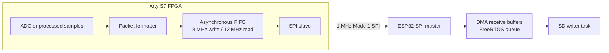

# FPGA–ESP32 Transport: Architecture and Design Decisions

The Arty S7 FPGA handles acquisition and fixed-point signal processing; an ESP32 receives its packetized output and writes it to an SD card. The interface is designed to decouple FPGA sample timing from SPI transactions and relatively slow, variable-latency SD-card writes.

The central choices are a dual-clock FIFO, sequence-numbered packets, ESP32-initiated SPI reads, and a separate SD writer task. The measured integrity test is documented in [Transport Hardware Validation](../results/hardware-validation/transport/README.md).

## 1. End-to-end data path



The [baseline FPGA top](../rtl/validation_only/base_top.v) sends raw ADC samples. The [CIC top](../rtl/validation_only/cic_top.v) and [Goertzel integration tops](../rtl/goertzel_top_parallel.v) use the same transport principles for processed samples and state/timing metadata. Those packet payloads differ by top-level design; the transport mechanism is shared.

| Interface | Configuration |
|---|---|
| FPGA packet/FIFO write clock | 8 MHz |
| FIFO read and SPI-slave clock | 12 MHz |
| SPI serial clock | 1 MHz, generated by ESP32 |
| SPI protocol | Mode 1, MSB first |
| Acquisition SPI read | 512-byte burst |
| Final drain | One byte per SPI transaction |
| Firmware buffer pool | 64 DMA-compatible buffers |

## 2. Why use an asynchronous FIFO?

The FPGA serializes source samples into bytes in an 8 MHz domain while the custom SPI slave operates in a 12 MHz domain. An asynchronous FIFO provides the clock-domain boundary and permits bursts of acquisition data to accumulate while the ESP32 performs other work.

The IP is configured for independent clocks and first-word-fall-through (FWFT) behavior. The packet formatter checks FIFO `full` before a write; the SPI slave uses `empty` and `valid` to decide whether a byte can be read. The [FIFO IP customization](../fpga/ip/fifo_generator_0_1.xci) records the core settings.

Why this matters: SPI transfer opportunities do not occur at the same instant as ADC or CIC output-valid pulses. Buffering prevents the producer and consumer from needing a cycle-by-cycle shared handshake across unrelated clocks. It does not guarantee infinite capacity: a sustained producer rate above the transfer/storage capacity could still cause drops.

## 3. Why packetize with sequence numbers?

The baseline transport sends a six-byte session header followed by six-byte sample frames.

Session marker

```text
55 AA 55 AA D4 06
```

Baseline sample frame

| Byte | Meaning |
|---:|---|
| 0 | Sequence bits 19:12 |
| 1 | Sequence bits 11:4 |
| 2 | Sequence bits 3:0, then sample bits 11:8 |
| 3 | Sample bits 7:0 |
| 4 | Type byte `0x00` |
| 5 | Frame marker `0xA3` |

A 20-bit sequence counter advances on each valid input sample, even if the serializer cannot enqueue that sample. When MATLAB decodes the recording, unexpected sequence jumps can reveal losses; payload checks additionally detect corruption of the known test pattern. The sequence wraps modulo 2^20 and resets when acquisition restarts.

The CIC and Goertzel tops carry different six-byte record types, including signed CIC samples, timing counts, and Goertzel final-state fragments. Their decoders reconstruct the higher-level values from the packet stream. See the [Goertzel hardware report](../results/hardware-validation/goertzel/README.md) and [MATLAB capture parser](../matlab/hardware-validation/goertzel/parser.m) for those formats.

This framing was chosen for offline traceability, not as a cryptographic integrity mechanism or a guarantee that every possible loss is detectable.

## 4. Why ESP32-initiated burst reads?

The ESP32 is the SPI master, so it controls when to move data and how many bytes to receive. A `prog_full` GPIO from the FPGA signals when to read:

- During acquisition: The FIFO's programmable-full threshold, synchronized into the system clock domain, requests a 512-byte burst.
- After acquisition stops: The signal indicates remaining FIFO data so the ESP32 can drain the final bytes rather than waiting for another programmable-full event.

The [SPI slave](../rtl/transport/spi_slave.v) synchronizes external chip select and serial clock to its 12 MHz domain. It shifts FIFO bytes onto MISO most-significant-bit first.

The 1 MHz SPI clock is conservative relative to the configured logic clocks. Its suitability depends on the actual packet-production rate and available FIFO capacity; one should not infer unconstrained throughput or absence of overflow from the clock values alone.

## 5. Why separate SPI reception from SD writes?

SD-card writes can pause unpredictably. The [ESP32 firmware](../firmware/main/main.c) receives SPI bytes into DMA-compatible buffers and passes filled buffers to a FreeRTOS writer queue, rather than waiting for every SD write before resuming reception.

The [SD logger](../firmware/main/sd_logger.c) uses a pool of 64 receive buffers, a 64 KiB buffered file stream, periodic flushing, and final synchronization. The writer returns buffers to the free queue after writing. If buffers are temporarily exhausted, the acquisition task retries for a bounded time and reports failure if backpressure persists.

On shutdown, the ESP32 deasserts acquisition enable, drains remaining FPGA FIFO bytes using single-byte SPI transactions, flushes the writer queue, and closes the capture file. These steps aim to avoid leaving a partial burst stranded after acquisition ends.

## 6. What has been verified?

For physical transport validation, the [hardware test top](../rtl/validation_only/transport_hw.v) replaces analog samples with an eight-value deterministic 12-bit pattern at 1,000 frames/s. The FPGA sends the stream through the packet formatter, FIFO, and SPI slave to the ESP32's SD card.

The [MATLAB checker](../matlab/hardware-validation/transport/synthetic_transport_validation.m) reported 286,463 decoded frames with no detected sequence gaps, duplicate frames, payload mismatches, or framing errors in the captured run.

This verifies the tested end-to-end digital transfer under that recording's conditions, not exhaustive losslessness across arbitrary FIFO pressure, card stalls, or repeated acquisition sessions. The dedicated [simulation transport top](../rtl/validation_only/transport_sim.v) is distinct from the physical [hardware-pattern top](../rtl/validation_only/transport_hw.v).

Full validation conditions and numbers: [FPGA–ESP32 Transport Hardware Validation](../results/hardware-validation/transport/README.md).

## Source navigation

- [Baseline FPGA top](../rtl/validation_only/base_top.v) · [CIC top](../rtl/validation_only/cic_top.v) · [Goertzel parallel top](../rtl/goertzel_top_parallel.v)
- [SPI slave](../rtl/transport/spi_slave.v) · [FIFO IP configuration](../fpga/ip/fifo_generator_0_1.xci)
- [ESP32 acquisition](../firmware/main/main.c) · [SPI driver](../firmware/main/fpga_spi.c) · [SD logger](../firmware/main/sd_logger.c)
- [Transport integration testbench](../tb/transport/tb_transport_integration.v) · [Hardware-pattern checker](../matlab/hardware-validation/transport/synthetic_transport_validation.m)
