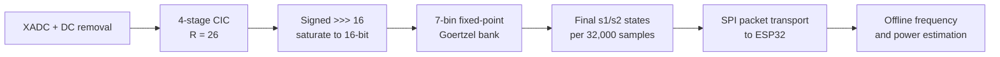
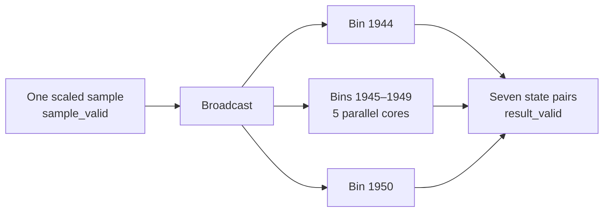
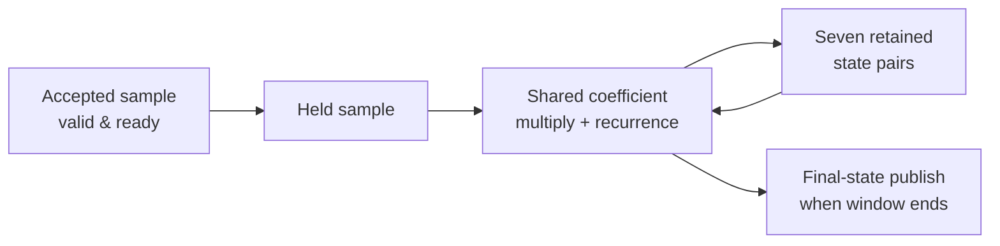

# Seven-Bin Goertzel: Fixed-Point Design and FPGA Architectures

The Goertzel stage extracts seven frequency bins around 60 Hz from the decimated ADC signal. Because the project needs a narrow frequency region rather than a complete spectrum, it computes only those bins rather than a full FFT.

It traces the main design decisions from MATLAB studies into the parallel and shared RTL implementations. Detailed measurements are in [FPGA validation](../results/hardware-validation/goertzel/README.md) and [synthesis results](../results/synthesis/README.md).

## Implemented signal path



| Property | FPGA configuration |
|---|---|
| Input sample rate | Approximately 986.193294 samples/s after CIC |
| Observation length | 32,000 accepted samples, nonoverlapping (~32.45 s) |
| Frequency bins | k = 1944–1950, seven neighboring DFT bins |
| Bin spacing | Approximately 30.819 mHz |
| Goertzel input | Signed 16-bit, from CIC signed 32-bit `>>> 16` with saturation |
| Coefficients | Signed 26-bit Q2.24 |
| Recurrence states | Signed 36-bit |
| Captured output | Seven final `s1`/`s2` state pairs per observation |

The FPGA records final recurrence states and sample/timing packets. ENF (electrical network frequency) and spectral-power features are reconstructed offline. The separate historical-recording calibration does not run as an FPGA authentication classifier.

## 1. Why seven frequency bins?

For a sampling rate \(F_s\) and window length \(L\), DFT bin \(k\) corresponds to \(kF_s/L\). The selected FPGA grid has L = 32,000 and approximately 30.819 mHz bin spacing.

Frequency is estimated by finding the strongest of the seven bin powers and fitting a three-point parabola to the logarithms of that bin and its neighbors. A peak at the edge of the bank has no two-sided neighborhood, so the estimate cannot be interpolated using this method.

The [frequency-bank study](../matlab/dsp-design/goertzel/01_frequency_bank_study.m) evaluated five, seven, and nine bins using 366 common synthetic tests (59.94–60.06 Hz, multiple phases and noise realizations), plus a separate recorded-data comparison:

| Candidate | Valid synthetic estimates | Edge-bin failures | Recurrence updates per window |
|---|---:|---:|---:|
| 5 bins | 77.05% | 22.95% | 160,000 |
| 7 bins | 100% | 0% | 224,000 |
| 9 bins | 100% | 0% | 288,000 |

Decision: Seven bins avoided the five-bin edge failures in the tested frequency range, while requiring 22.2% fewer recurrence updates than nine bins. These are *algorithmic operations*, not LUT/DSP counts. The study's accuracy comparisons use a separate 1,000 Hz WAV grid; their measured estimator differences are not universal guarantees for the FPGA setup.

## 2. Why a 16-bit input and shift by 16?

The unnormalized CIC output is signed 32-bit and can be substantially larger than the ADC input because the four-stage filter has DC gain 26^4 = 456,976. Passing it directly to every Goertzel recurrence increases arithmetic width and cost.

The [CIC-to-Goertzel scaling study](../matlab/dsp-design/goertzel/02_input_scaling_study.m) compared widths from 13 to 32 bits on four synthetic signals. To isolate input quantization, it used double-precision Goertzel arithmetic:

| Goertzel input | CIC arithmetic shift | Worst input signal-to-quantization-noise ratio (SQNR) | Worst normalized power error |
|---|---:|---:|---:|
| 13 bits | 19 | 29.977 dB | 0.12545% |
| 16 bits | 16 | 47.989 dB | 0.012359% |
| 20 bits | 12 | 72.044 dB | 0.0008377% |
| 24 bits | 8 | 96.139 dB | 0.0000630% |

Decision: Signed 16-bit input offered a useful balance between retaining low-amplitude precision and limiting multiplier/state widths. The tested 16-bit scaling improved the worst observed SQNR by roughly 18 dB over 13-bit scaling.

The RTL performs a signed arithmetic shift and then bounds the result to the 16-bit range. The recorded-sample hardware validation applies the same scaling before integer replay. No clipping was observed in the four numerical design-study signals; that does not imply saturation can never occur.

## 3. Why Q2.24 coefficients and 36-bit recurrence states?

For each selected bin, the fixed-point recurrence is

```text
s0 = x + ((C × s1) >>> F) - s2
s2 = s1
s1 = wrap_to_signed_W(s0)
```

Here \(C\) approximates \(2\cos(2\pi k/L)\), \(F\) is its fractional-bit count, and \(W\) is the recurrence-state width. The signed product is retained at full product precision before arithmetic shifting. State assignment intentionally wraps to the configured signed width, rather than saturating.

The [precision study](../matlab/dsp-design/goertzel/03_fixed_point_precision.m) tested Q2.18, Q2.20, and Q2.24, each with 32-, 36-, and 40-bit states, over five synthetic signal classes. For 36-bit states:

| Coefficient precision | Worst normalized complex-spectrum error | Worst normalized spectral-power error |
|---|---:|---:|
| Q2.18 | 3.7879% | 2.1450% |
| Q2.20 | 1.1680% | 0.62609% |
| Q2.24 | 0.077622% | 0.030602% |

Decision: Q2.24 substantially reduced arithmetic error versus Q2.20. In the tested signals, no candidate state width overflowed, but 36 bits provided approximately 4.9 bits of minimum observed headroom, compared with less than one bit at 32 bits. The extra width is a margin justified by the study, not a mathematical proof of overflow freedom for arbitrary inputs.

The [end-to-end fixed-point study](../matlab/dsp-design/goertzel/04_end_to_end_fixed_point.m) also evaluated CIC scaling and Goertzel arithmetic together. Its selected 16-bit/36-bit configuration achieved 0.034161% worst normalized spectral-power error across four synthetic test signals versus the full-precision spectral reference. This is numerical-design evidence, not a physical FPGA accuracy measurement.

## 4. Two RTL implementations of the same recurrence

Both banks retain seven independent `s1`/`s2` state pairs and publish fourteen signed 36-bit final states per 32,000-sample window. They differ primarily in how arithmetic is scheduled.

### Parallel bank — maximum input throughput

[Parallel bank RTL](../rtl/goertzel/parallel/goertzel_bank.v) instantiates seven [single-bin cores](../rtl/goertzel/parallel/goertzel_bin.v). Each bin has its own multiplier/recurrence datapath; the accepted input and first/last flags are broadcast.



All seven bins update together, so this bank can accept one valid sample per processing clock. The implementation needs no backpressure interface; first/last flags select and capture the window boundaries.

### Shared bank — lower arithmetic-resource cost

[Shared bank RTL](../rtl/goertzel/shared/goertzel_bank_shared.v) retains separate state registers but processes the bins sequentially through LOAD → MULTIPLY → UPDATE, followed by PUBLISH at the end of a window.



The engine signals `sample_ready` only when idle and requires approximately 23 processing clocks per accepted sample at sustained input. The last sample takes an additional publication cycle. This trades sample-rate headroom for lower DSP/LUT consumption.

Integration caveat: The [shared FPGA top](../rtl/goertzel_top_shared.v) does instantiate the shared bank, but its upstream `g_valid` and window counter do not currently gate advancement on `g_sample_ready`. At the nominal sampling rate, CIC outputs are separated by roughly 8,112 FPGA clocks, far longer than the shared-bank processing sequence, so the intended operating rate provides ample nominal time. Nevertheless, this is not a general backpressure-safe connection; an interface-level assertion or buffering would be needed to guarantee acceptance under arbitrary arrival patterns.

### Resource tradeoff

Standalone Vivado 2024.2 synthesis of each bank for Spartan-7 XC7S50 gave:

| Resource | Parallel | Shared |
|---|---:|---:|
| DSP48E1 | 28 | 4 |
| Slice LUTs | 1,023 | 357 |
| Slice registers | 1,009 | 1,629 |

The shared version uses 85.7% fewer DSPs and 65.1% fewer LUTs, but 61.4% more registers and more cycles per input. These are post-synthesis standalone counts, not complete-system or post-route measurements. See the [full synthesis comparison](../results/synthesis/README.md) for the conditions and limits.

## 5. How correctness is checked

This project separates three kinds of evidence:

- Numerical design: MATLAB studies the frequency bank, scaling, finite precision, and end-to-end error. The [integer reference model](../matlab/fixed-point-models/goertzel_fixed_model.m) implements the recurrence independently of Verilog.
- RTL simulation: [Parallel testbench](../tb/goertzel/tb_goertzel_parallel.v) and [shared testbench](../tb/goertzel/tb_goertzel_shared.v) check recurrence states and window/control behavior. The parallel testbench uses the standalone [simulation wrapper](../rtl/validation_only/goertzel_sim.v).
- Physical captures: Recorded CIC samples are replayed through the integer model and compared against FPGA final states. The parallel capture matched 126/126 states, and a separate operator-labeled shared capture also matched 126/126 states. The shared bitstream identity is not encoded in the capture, so its provenance remains operator-reported. The same windows were also compared with MATLAB ROOT-MUSIC for frequency-estimator agreement.

The capture comparisons validate the observed arithmetic, not every upstream handshake or reset scenario. Full evidence and limitations are in [Goertzel hardware results](../results/hardware-validation/goertzel/README.md).

## 6. Separate ENF/ENV calibration work

The [historical ENF/ENV study](../results/enf-env-calibration/README.md) evaluated synthetic frequency-bias correction and frequency-dependent spectral-power compensation using recordings sampled at 1,000 Hz, with bins 1917–1923. The FPGA hardware uses approximately 986.193 Hz and bins 1944–1950. Both use the same basic fixed-point recurrence, but calibration tables from the WAV study are not directly validated FPGA lookup tables.

This separation matters: hardware validation establishes the tested fixed-point processing path; historical-signal analysis explores whether its types of features can reproduce meaningful reference behavior.

## Implementation and evidence

- [Goertzel MATLAB design studies](../matlab/dsp-design/goertzel/) · [Goertzel integer model](../matlab/fixed-point-models/goertzel_fixed_model.m)
- [Parallel bank](../rtl/goertzel/parallel/goertzel_bank.v) · [Shared bank](../rtl/goertzel/shared/goertzel_bank_shared.v)
- [Parallel FPGA top](../rtl/goertzel_top_parallel.v) · [Shared FPGA top](../rtl/goertzel_top_shared.v)
- [Hardware validation](../results/hardware-validation/goertzel/README.md) · [Synthesis results](../results/synthesis/README.md)
