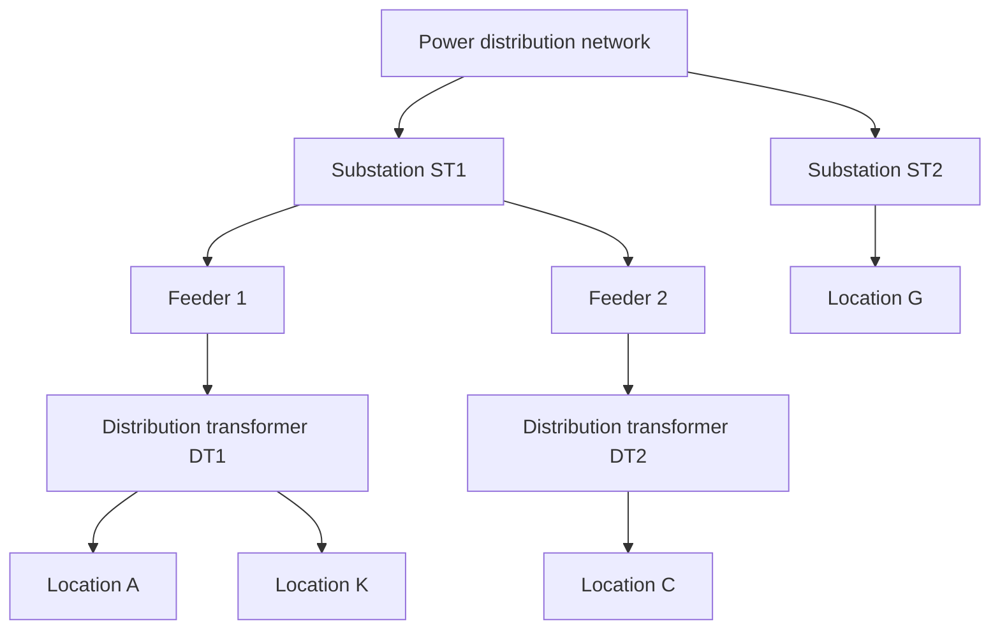

# ENF/ENV Calibration: MATLAB Evaluation

Across three hours of recorded grid signals, calibration reduced average Goertzel-to-MUSIC frequency-estimator disagreement from 3.809 to 0.610 mHz (84.0%). Power compensation also brought the location-pair correlation patterns closer to the MUSIC reference.

This study evaluates MATLAB fixed-point models on historical recordings, not additional FPGA captures or a completed location-authentication system. The aim was to determine whether inexpensive, FPGA-compatible Goertzel features could reproduce useful frequency and location-related characteristics of a more computationally intensive estimator.

## What is being compared?

- ENF (electrical network frequency): The estimated fluctuation of the nominal 60 Hz grid frequency. MAE is the mean absolute difference between two frequency estimates; 1 mHz is 0.001 Hz. For historical recordings, MUSIC is a comparison estimator, not ground truth.
- ENV-related power feature: A signal-strength proxy computed from the Goertzel bins. Correlation (Pearson r) describes how closely two recordings' power variations rise and fall together; it does not establish identical amplitudes or physical voltage envelopes.

## Recording setup

This evaluation follows the measurement-location relationships described by Zhang et al. in [*Feasibility Study of Location Authentication for IoT Data Using Power Grid Signatures* (2025)](https://doi.org/10.1109/OJSP.2025.3530847). The diagram summarizes the electrical topology relevant to comparing location-pair signals.

A and K share a feeder and transformer; C is served by the same substation through a separate feeder and transformer; G is associated with another substation. The topology is schematic and does not predict the magnitude of measured correlations.
 

| Test setting | Value |
|---|---|
| Recordings | Four locations (A, K, C, G), December 21, 2023 |
| Evaluation period | 09:00–12:00; three consecutive one-hour segments |
| WAV sampling rate | 1,000 samples/s |
| Fixed-point Goertzel | Seven bins, k = 1917–1923; 32,000-sample (32 s) windows |
| Recurrence format | Signed 16-bit samples, Q2.24 coefficients, signed 36-bit states |
| MUSIC reference | Band-limited to 59.8–60.2 Hz; 10 s frames with 1 s hop |

The MUSIC features are aligned and aggregated onto the Goertzel windows before comparison. This experiment's 1,000 Hz sample rate and selected bins differ from the FPGA capture configuration (approximately 986.193 Hz; bins 1944–1950).

## Main results

| Evaluation | Before correction | After correction | Meaning |
|---|---:|---:|---|
| 5C: Synthetic frequency error, held-out cases | 3.6211 mHz | 0.04326 mHz | 98.8% less error versus known test frequencies, on 944 covered cases |
| 5E: Recorded frequency difference vs MUSIC, three-hour average | 3.809 mHz | 0.610 mHz | 84.0% less estimator disagreement |
| 5E: Location-pair correlation difference vs MUSIC | 0.5544 | 0.0702 | 87.3% smaller discrepancy across six three-hour *mean* pair correlations |

The last result compares six mean correlation coefficients—not a pooled correlation or a classification success rate.

## Experiments 5A–5E

### 5A–5B. Establish uncorrected reference and fixed-point behavior

[5A — MUSIC reference](../../matlab/enf-env-calibration/01_music_reference.m) extracts the frequency estimates and raw power features used for comparison. [5B — Goertzel baseline](../../matlab/enf-env-calibration/02_goertzel_baseline.m) processes 112 nonoverlapping windows per location in the first hour.

The uncorrected Goertzel frequency estimates differed from MUSIC by roughly 3.79–3.82 mHz on average across the four locations. More importantly for location-related analysis, raw Goertzel power could show high correlations even between geographically distinct recordings: A–G r = 0.8620, while the corresponding MUSIC raw-power correlation was −0.5300 in the first-hour baseline. That mismatch motivated power compensation.

### 5C. Correct frequency-estimation bias without fitting to MUSIC

[5C — Frequency calibration](../../matlab/enf-env-calibration/03_enf_calibration.m) fits lookup tables (LUTs) from known-frequency synthetic sinusoids, separately for each dominant Goertzel bin. Held-out test frequencies, amplitudes, and phases differ from the training signals.

| Synthetic validation | Result |
|---|---:|
| Valid raw frequency estimates | 960 / 960 |
| Within calibration LUT range | 944 / 960 |
| Raw MAE on those 944 cases | 3.6211 mHz |
| Calibrated MAE on those same cases | 0.04326 mHz |
| Largest calibrated error | 4.7063 mHz |

The largest held-out error was 4.7063 mHz despite the small mean. On first-hour recorded signals, the same LUTs yielded 0.576–0.622 mHz mean differences from MUSIC across locations, using 110 covered windows per location.

### 5D. Compensate the frequency dependence of Goertzel power

[5D — Power compensation](../../matlab/enf-env-calibration/04_env_compensation.m) uses synthetic signals to model how the sum of seven Goertzel-bin powers varies with input frequency. It divides observed power by this modeled gain at the *calibrated* frequency.

In the first hour, this reduced the mean absolute difference from MUSIC's six location-pair correlations from 0.8260 to 0.1022 (87.6%). This indicates much closer *relationships between locations*; it does not mean the two power measurements have identical physical units or amplitudes.

### 5E. Evaluate three hours without recalibration

[5E — Cross-hour validation](../../matlab/enf-env-calibration/05_cross_hour_validation.m) applies the unchanged 5C frequency LUTs and 5D gain curve to all three recorded hours.

| Hour | Raw frequency MAE vs MUSIC | Corrected MAE | Raw-power vs MUSIC correlation | Corrected-power vs MUSIC correlation |
|---|---:|---:|---:|---:|
| 09:00–10:00 | 3.8521 mHz | 0.5961 mHz | 0.3769 | 0.9530 |
| 10:00–11:00 | 3.5186 mHz | 0.6357 mHz | 0.1325 | 0.8800 |
| 11:00–12:00 | 4.0551 mHz | 0.5976 mHz | 0.2963 | 0.8940 |

*Each entry is an arithmetic mean of the four location-specific measurements in that hour. The correlation columns compare each location's power trace to its MUSIC counterpart.*

The two additional hours provide a check beyond the initial first-hour evaluation.

#### Do location relationships improve?

The following are each location pair's mean correlation across three hours. Higher correlation means the two recorded power traces fluctuate more similarly; for this comparison, matching MUSIC's location-pair patterns matters more than maximizing correlation everywhere.

| Location pair | MUSIC raw power | Raw Goertzel power | Compensated Goertzel power |
|---|---:|---:|---:|
| A–K (same feeder) | 0.9873 | 0.9885 | 0.9407 |
| A–C | 0.5512 | 0.9133 | 0.5625 |
| A–G | −0.0881 | 0.8816 | 0.0621 |
| K–C | 0.5589 | 0.9078 | 0.5628 |
| K–G | −0.1071 | 0.8907 | 0.0677 |
| C–G | 0.2112 | 0.8581 | 0.2455 |

Compensation preserves a relatively strong A–K relationship while reducing the misleadingly high uncorrected correlations for several other pairs. These are feature correlations, not classifier-accuracy measurements.

## Analysis sources

The [MUSIC reference](../../matlab/enf-env-calibration/01_music_reference.m), [uncalibrated Goertzel model](../../matlab/enf-env-calibration/02_goertzel_baseline.m), [frequency calibration](../../matlab/enf-env-calibration/03_enf_calibration.m), [power compensation](../../matlab/enf-env-calibration/04_env_compensation.m), and [cross-hour evaluation](../../matlab/enf-env-calibration/05_cross_hour_validation.m) contain the five studies. See [Goertzel architecture](../../architecture-docs/goertzel.md) for the related fixed-point design decisions.

