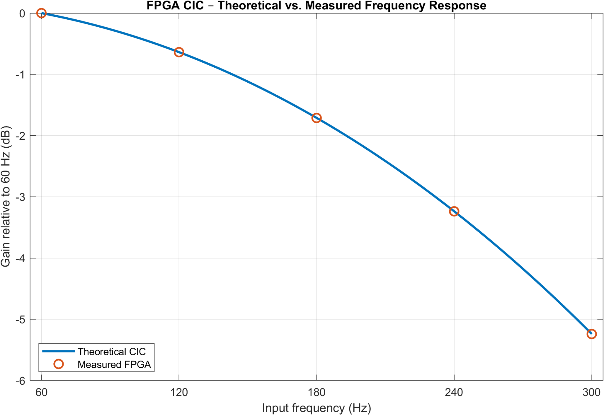
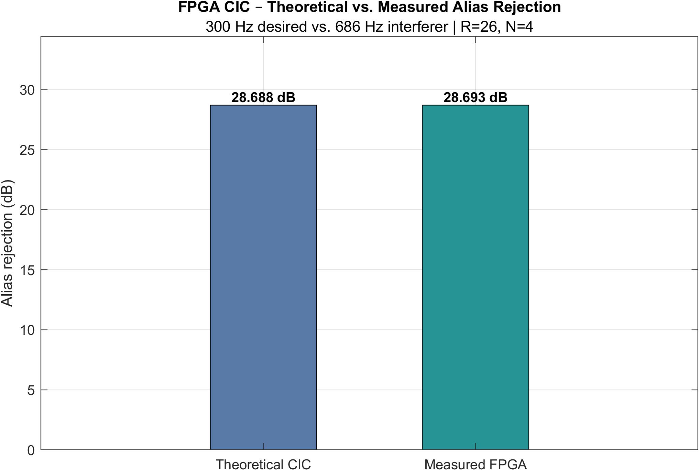

# CIC Decimator: FPGA Hardware Validation

Result: FPGA measurements agreed with the predicted CIC frequency response within 0.001183 dB at five test frequencies.

The four-stage CIC decimator (R = 26, M = 1) was tested on an Arty S7 using function-generator inputs. Signed 32-bit decimator outputs were captured by the ESP32 over SPI and analyzed in MATLAB. These are physical hardware measurements, not RTL simulation results.

## Frequency-response measurement

Five equal-amplitude sine-wave inputs were applied separately. The reported gain is relative to the measured 60 Hz output, so 60 Hz is defined as 0 dB. After discarding the first second to allow settling, MATLAB fitted each recorded sinusoid and compared its amplitude with the theoretical four-stage CIC response.

| Input tone | Measured gain | Predicted gain |
|---:|---:|---:|
| 60 Hz | 0.000 dB | 0.000 dB |
| 120 Hz | −0.638 dB | −0.638 dB |
| 180 Hz | −1.712 dB | −1.711 dB |
| 240 Hz | −3.237 dB | −3.237 dB |
| 300 Hz | −5.241 dB | −5.240 dB |

Largest measured deviation from theory: 0.001183 dB. The output attenuation increases with frequency as expected for this CIC configuration.

## Alias-rejection measurement

Inputs at 300 Hz and 686 Hz were tested separately at nominally equal amplitudes. With a measured CIC output rate near 986.193 Hz, a 686 Hz input aliases near 300 Hz after decimation. The experiment measures how much more strongly the filter suppresses this unwanted 686 Hz input than the desired 300 Hz input.

| Rejection at 686 Hz relative to 300 Hz | Value |
|---|---:|
| Theoretical | 28.6880 dB |
| Measured | 28.6925 dB |
| Difference | +0.0045 dB |

The measured attenuation difference was close to prediction. This test isolates one aliasing frequency pair; it is not a measurement of worst-case rejection across the entire stopband. The calculation assumes the applied tone amplitudes were equal, as configured in the analysis script.

## Source and methodology

- [CIC RTL](../../../rtl/preprocessing/cic_decimator.v) and [CIC testbench](../../../tb/preprocessing/tb_cic_decimator.v)
- [Measured frequency-response analysis](../../../matlab/hardware-validation/cic/frequency_response.m) and [alias-rejection analysis](../../../matlab/hardware-validation/cic/alias_rejection.m)
- [CIC design rationale](../../../architecture-docs/cic_decimator.md) and [theoretical DSP study](../../../matlab/dsp-design/cic/frequency_response.m)

The input recordings are not part of this GitHub results directory. Values shown here are documented outputs of the hardware-analysis experiments, not results regenerated during this documentation update.
